# LoreKeeper · 网文设定守护者

> 一个面向长篇连载场景的 **AI Agent 应用**：用「意图路由 + ReAct 自主规划 + Agentic RAG + MCP 工具生态」把「设定一致性」这件高度依赖人工记忆的事，变成可检索、可推理、可审查、可人机协同的闭环。

**技术标签**：`Java 21` `Spring Boot 3.5` `Spring AI (M6)` `ReAct Agent` `MCP` `RAG` `pgvector` `Hybrid Search / RRF / Rerank` `多租户隔离` `Vue 3 + Vite` `SSE 流式`

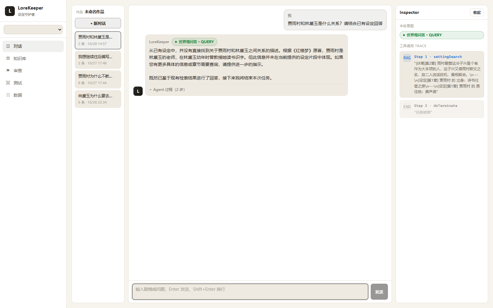

> **对话台**：左侧多会话记忆，中间意图路由徽章（世界观问答 · QUERY）与 Agent 过程（2 步），右侧 **Inspector** 实时展示工具调用 Trace —— `Step 1 · settingSearch`（RAG 检索，带命中片段）→ `Step 2 · doTerminate`（终止协议）。Agent 的每一步决策都可见、可追溯。

---

## 目录

- [1. 项目背景与痛点](#1-项目背景与痛点)
- [2. 系统架构](#2-系统架构)
- [3. 功能模块](#3-功能模块)
- [4. 技术选型](#4-技术选型)
- [5. 工程亮点](#5-工程亮点)
- [6. 效果评测](#6-效果评测)
- [7. 快速开始](#7-快速开始)
- [8. 项目结构](#8-项目结构)
- [9. 接口一览](#9-接口一览)
- [10. 数据模型](#10-数据模型)
- [11. 已知取舍与后续规划](#11-已知取舍与后续规划)

---

## 1. 项目背景与痛点

长篇网文连载（动辄百万字、数百章）中，"设定崩坏"是最难靠人力兜住的问题：

| 痛点                 | 具体表现                                                                |
| -------------------- | ----------------------------------------------------------------------- |
| **人肉记忆不可靠**   | 第 80 章写"主角惯用左手"，第 300 章写成右手，作者自己都记不住           |
| **检索手段缺失**     | 想确认"英莲的身世在第几章定过"，只能全文 Ctrl+F，还搜不到语义相近的表述 |
| **伏笔失控**         | 埋了 30 个伏笔，忘了回收，读者在评论区点名                              |
| **通用大模型不可用** | 直接把整本丢进 ChatGPT 会超上下文；而"让模型凭记忆回答"必然产生幻觉     |

**LoreKeeper 的解法**不是做一个聊天机器人，而是构建一条**"事实入库 → 语义索引 → Agent 检索推理 → 冲突检测 → 人工裁决"**的工程闭环：

- 事实以**结构化四元组**（`entity / attribute / value / evidence`）落库，每条断言都带原文证据与出处章节；
- 事实同时写入 **pgvector** 做语义索引，支持召回；
- 用户提问先过**意图路由**分派到 5 条工作流，交由 **ReAct Agent** 自主规划工具调用；
- 抽取与比对环节的冲突不自动覆写，而是进入**待确认队列**交给人裁决（Human-in-the-loop）。

---

## 2. 系统架构

### 2.1 总体架构

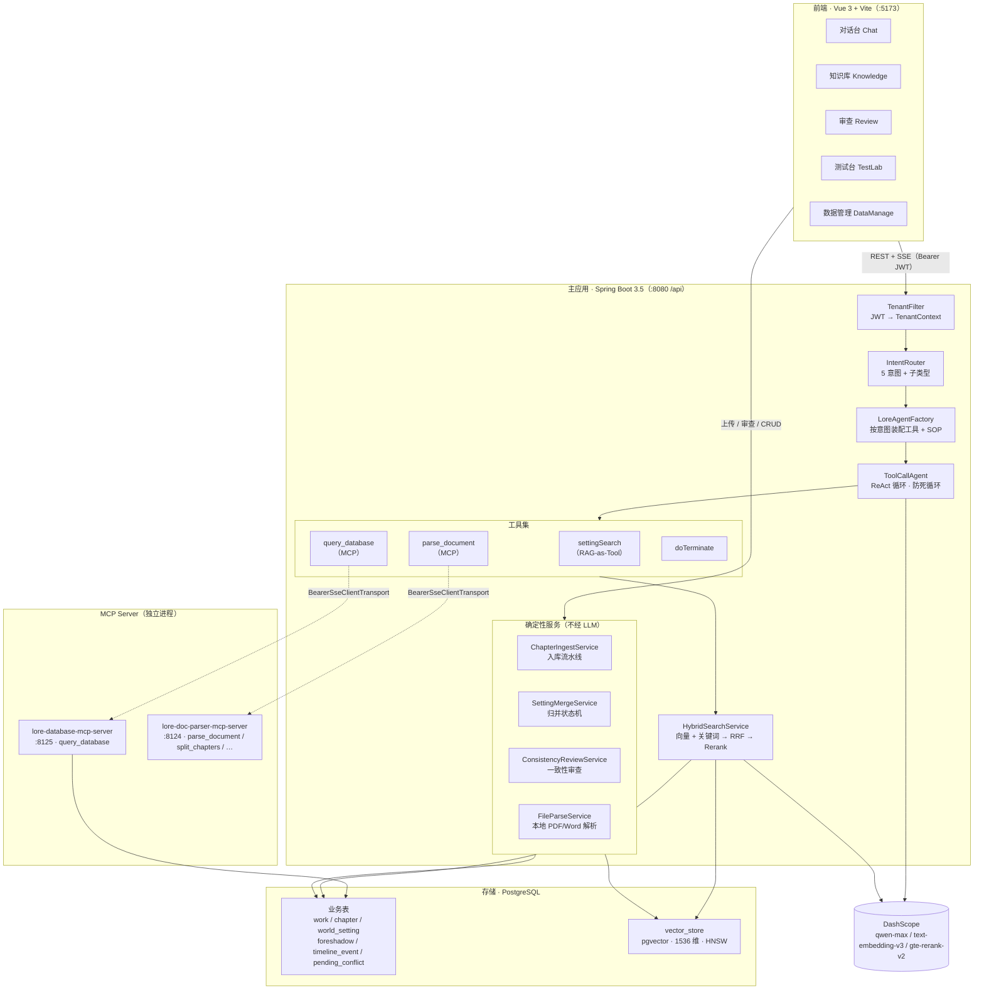

### 2.2 一次对话的完整链路（SSE 流式）

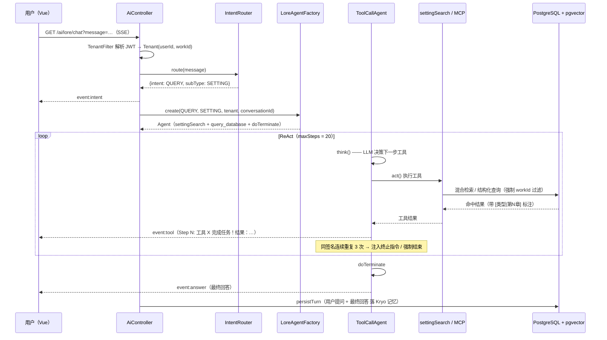

### 2.3 多租户隔离：三层防线

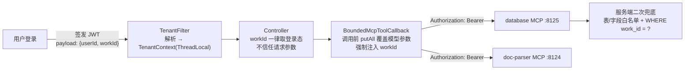

> **为什么需要第 3 层？** MCP 工具的参数是**由 LLM 填的**，模型理论上可以伪造 `workId` 越权读取他人作品。因此 `workId` 不交给模型决定，而是在工具调用前由服务端强制覆盖；MCP 服务端再以白名单 + `WHERE work_id = ?` 兜底。切换作品时后端**重签 JWT** 而非前端传参。

---

## 3. 功能模块

### 3.1 五意图 Agent 路由

用户一句话进来，先由 `IntentRouter` 做一次 LLM 结构化分类（`RouteResult` record），再按意图装配**不同的工具集 + 不同的 SOP prompt + 不同的检索过滤**：

| 意图         | 中文名     | 装配工具                                     | 检索裁剪策略                                    |
| ------------ | ---------- | -------------------------------------------- | ----------------------------------------------- |
| `WRITE`      | 设定提示   | settingSearch + doTerminate                  | 硬过滤 `type ∈ {setting, foreshadow}`           |
| `REVIEW`     | 一致性审查 | settingSearch + parseDocument + doTerminate  | 硬过滤 `type = setting`                         |
| `QUERY`      | 世界观问答 | settingSearch + query_database + doTerminate | `SETTING` 子类型启用优先召回 setting/foreshadow |
| `FORESHADOW` | 伏笔追踪   | settingSearch + query_database + doTerminate | 全量                                            |
| `CHAT`       | 闲聊       | 同 QUERY                                     | 全量                                            |

- `QUERY` 下再细分 `SETTING`（问设定/世界观事实）与 `CHAPTER`（问已写章节剧情）子类型，决定检索偏好。
- 路由解析失败 → 安全侧降级为 `CHAT`，不启用优先检索。

### 3.2 混合检索 RAG（Hybrid Search）

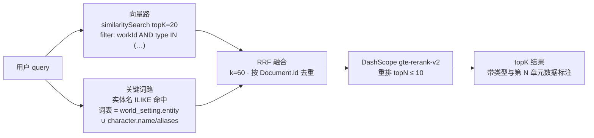

- **双路召回**：纯向量对"设定"这类短文本召回弱，因此补充实体名精确命中提权；
- **RRF 融合**：`1/(k + rank)` 累加，k=60，纯函数、可单测；
- **Rerank**：`gte-rerank-v2` 重排，失败自动降级为不重排；
- **类型过滤**：`FilterExpressionBuilder` 把 `workId + type` 下推到 pgvector，避免"章节原文挤占设定提示卡"。

### 3.3 章节入库流水线（确定性编排）

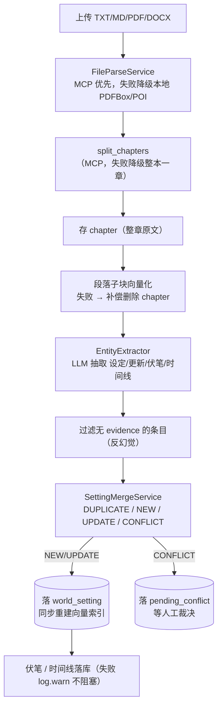

### 3.4 一致性审查与冲突裁决

- **归并状态机**：`DUPLICATE`（同实体同属性同值）→ 忽略；`NEW` → 落库；`UPDATE`（值变化）→ 落库 + version+1 + 重建向量；`CONFLICT` → **不覆写**，进待确认队列。
- **别名归一**：实体命中 `character.name/aliases` 时用标准名落库与比对，避免"林玄"与"主角"被拆成两个实体。
- **反向冲突扫描**：改设定后拿新设定当 query 检索章节 → LLM 判矛盾 → 代码层只保留 `isConflict=true`，并二次过滤 `type=chapter`。
- **人机协同**：`pending_conflict` 队列支持 accept / reject，`updateStatus` 带 `AND status='pending'` 幂等条件，防重复采纳。

### 3.5 前端 5 页控制台

| 页面                       | 路由      | 核心能力                                                                                     |
| -------------------------- | --------- | -------------------------------------------------------------------------------------------- |
| **对话台** `Chat.vue`      | `/`       | 三栏（会话列表 / 消息流 / Inspector）；SSE 命名事件驱动；意图徽章 + 逐步工具 Trace；可"停止" |
| **知识库** `Knowledge.vue` | `/rag`    | RAG 分块可视化（type chip / `ch#N` / entityId / 原文）；多文件批量上传 + 进度；级联删除确认  |
| **审查** `Review.vue`      | `/review` | 上传/粘贴章节 → 矛盾清单（实体/本章断言/历史断言/出处）+ 未回收伏笔 + 待确认队列采纳驳回     |
| **测试台** `TestLab.vue`   | `/test`   | MCP 工具真调（5 个工具 + 连通性 chip）、RAG 检索测试、意图路由测试                           |
| **数据** `DataManage.vue`  | `/data`   | 作品（新建/切换/编辑/删除）、设定、伏笔三 Tab CRUD                                           |

**知识库 —— RAG 分块可视化**：左侧章节/设定库/伏笔库三 Tab，右侧每个 chunk 展示 `type` chip、`ch#N`、字数、`parentId` 与原文，可直观检查分块策略与索引质量：

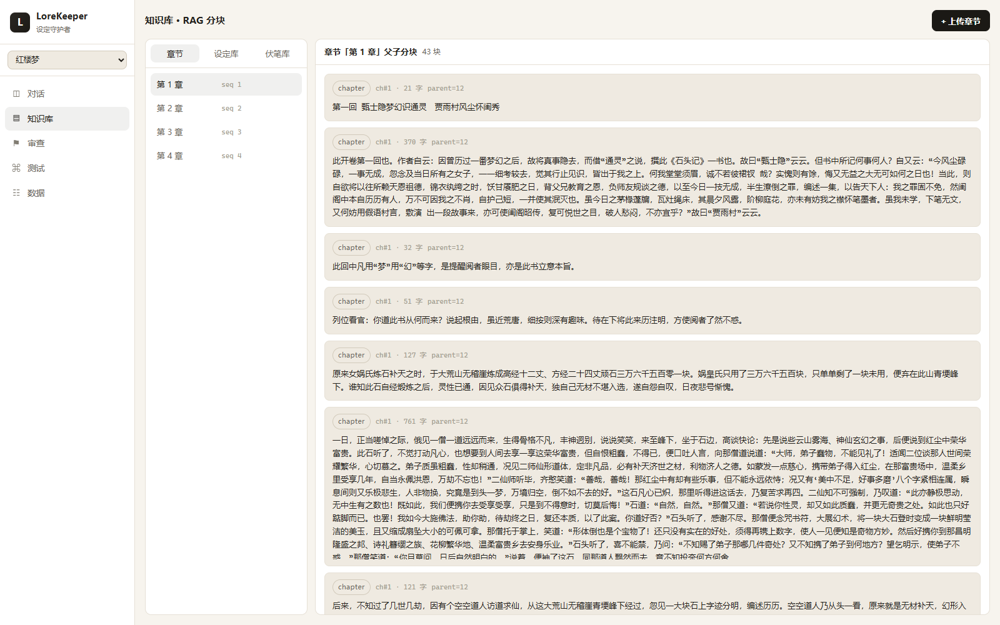

**测试台 —— MCP 工具真调**：顶部实时连通性状态（`doc-parser ●` / `database ●`），5 个 MCP 工具（`parse_document` / `query_database` / `split_chapters` / `parse_document_content` / `detect_encoding`）逐一真调，另有 RAG 检索测试与意图路由调试：

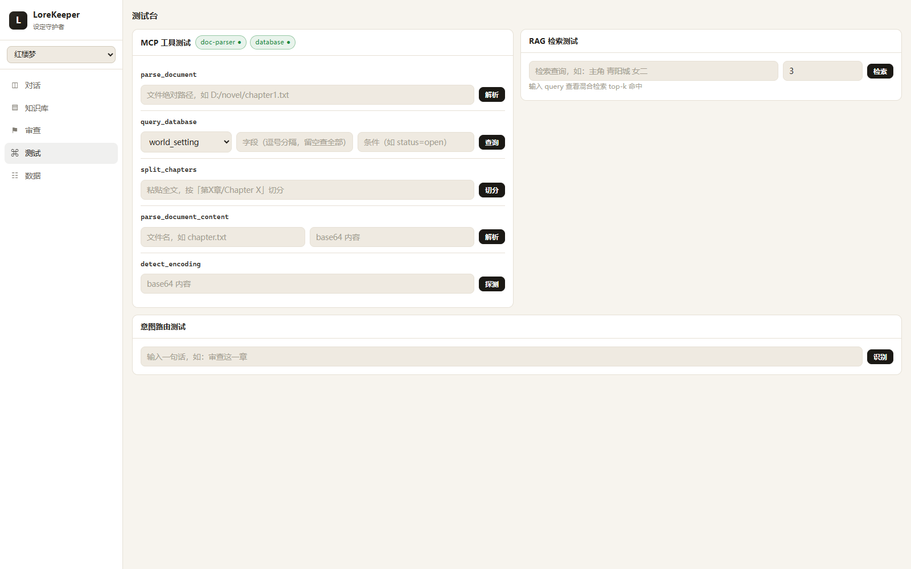

**设定库 —— 结构化四元组落库**：章节上传后由 `EntityExtractor` 抽取的 `实体 / 属性 / 值 / 版本`（含版本号，值变化自动 +1），保存时触发反向冲突扫描：

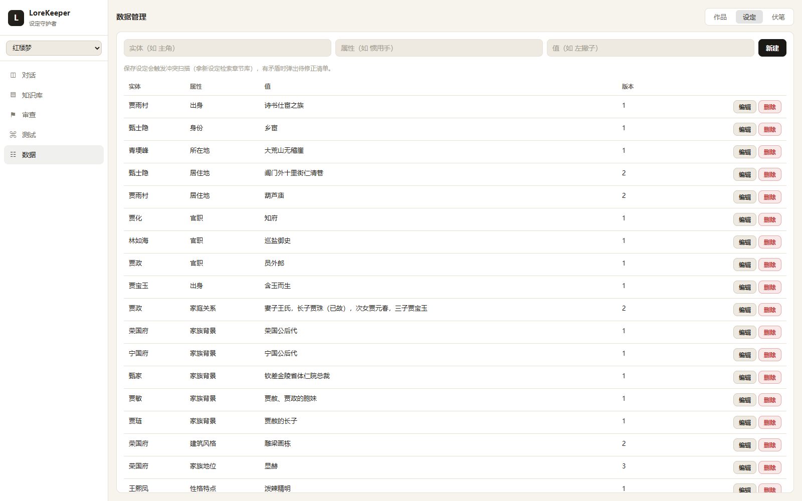

**一致性审查**：上传 TXT/MD/PDF/Word 或粘贴正文，输出矛盾清单与未回收伏笔；`CONFLICT` 进入下方**待确认队列**，人工采纳/驳回（人机协同）：

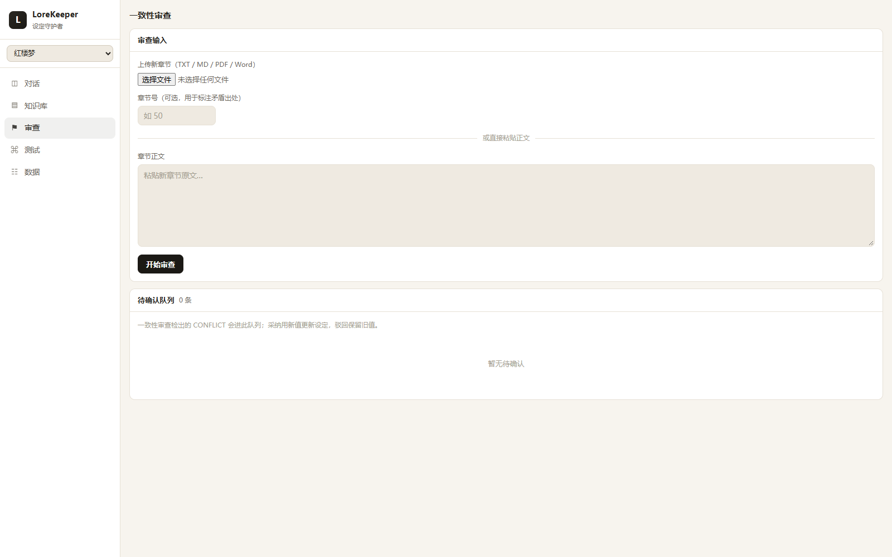

**数据管理 —— 多作品切换**：切换作品即后端重签 JWT（`workId` 随 token 走，前端不传参），全站数据随 `workStore.version` 广播刷新：

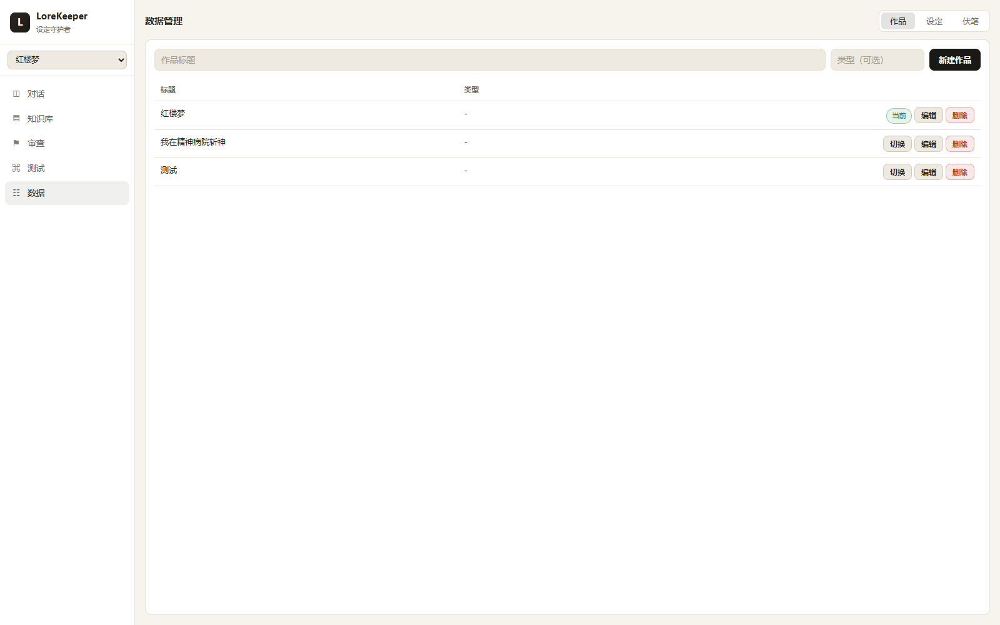

### 3.6 对话记忆与多会话

- `FileBasedChatMemory`（Kryo 序列化到 `{chat-memory-dir}/{userId}_{chatId}.kryo`）；
- 只落盘"用户输入 + 最终回答"，**工具中间消息不入记忆**，避免记忆爆炸；
- 写回放在 `finally` 而非 send 之后 —— 实测 SSE 客户端断开会让 send 之后的写回丢失。

---

## 4. 技术选型

| 层次          | 选型                              | 版本          | 选择理由 / 权衡                                                                                                     |
| ------------- | --------------------------------- | ------------- | ------------------------------------------------------------------------------------------------------------------- |
| 语言 / 运行时 | Java                              | **21**        | 虚拟线程友好、record + sealed 让 DTO/状态机表达简洁                                                                 |
| 基础框架      | Spring Boot                       | **3.5.10**    | 生态成熟，与 Spring AI 天然集成                                                                                     |
| AI 框架       | Spring AI                         | **1.0.0-M6**  | `ChatClient` / `VectorStore` / `ToolCallback` 抽象统一；M 版本意味着**需要自己填坑**（见 5.2）                      |
| 模型接入      | Spring AI Alibaba + DashScope SDK | M6.1 / 2.22.9 | 通义千问 `qwen-max` + `text-embedding-v3`(1536 维) + `gte-rerank-v2`                                                |
| 向量库        | **PostgreSQL + pgvector**         | M6            | **关键决策**：向量与业务数据同库 → 删除操作可在**单个 `@Transactional`** 内原子完成，避免"删了表、没删向量"的脏数据 |
| 检索          | 自研 HybridSearch                 | —             | Spring AI M6 无开箱混合检索，自研向量 + 关键词双路 RRF 融合 + Rerank                                                |
| 工具协议      | **MCP**（Model Context Protocol） | —             | 让"数据库查询""文档解析"成为可被 Agent 动态发现的独立服务，解耦部署                                                 |
| MCP 客户端    | `spring-ai-mcp-client`            | M6            | **官方 SSE transport 不支持自定义 header**，故自研 `BearerSseClientTransport`                                       |
| 文档解析      | PDFBox + POI                      | 3.0.4 / 5.4.1 | 主项目本地解析，见 5.6 的边界划分                                                                                   |
| 流式协议      | **SSE（SseEmitter）**             | —             | Agent 执行链路长，需要逐步回传过程；比 WebSocket 轻量、天然穿透代理                                                 |
| 记忆          | 自研 `FileBasedChatMemory` + Kryo | 5.6.2         | 轻量可落地；生产可平替为 Redis / PG                                                                                 |
| 鉴权          | 自研 JWT（hutool-jwt）            | —             | 无状态，payload 携带 `userId + workId`，天然承载租户上下文                                                          |
| 前端          | Vue 3 + Vite                      | 3.5 / 6       | `<script setup>` + 懒加载路由；**不引入 UI 框架**，551 行手写设计系统                                               |
| SSE 客户端    | `@microsoft/fetch-event-source`   | 2.0.1         | 原生 `EventSource` 不支持自定义 header（JWT 必须走 header）                                                         |
| 部署          | Docker / Nginx                    | —             | 前端 `node:20-alpine` 构建 → `nginx:alpine`；后端 `maven:3.9-corretto-21`                                           |

## 5. 工程亮点

### 5.1 自研 ReAct Agent 内核 + 三层防死循环

```
BaseAgent       状态机 / run() / runstream(SseEmitter) / 历史注入 / 记忆落盘
  └─ ReActAgent step() = think() + act()
       └─ ToolCallAgent  工具执行、终止协议
```

**问题**：新作品没有任何设定数据时，`WRITE` 工作流检索为空，LLM 把"没搜到"误判为"任务未完成"，反复调用 `settingSearch` 直到 `maxSteps=20` 耗尽，请求挂起 3 分钟才返回。

**解法**（代码层兜底，不依赖模型自觉）：

- **SOP 层**：写明"同一个 query 只检索一次，禁止重复检索；结果不理想也如实回答并 `doTerminate`"（软约束）；
- **代码层**：`ToolCallAgent` 记录工具调用签名（工具名 + 参数），**连续重复 3 次** → 注入强制终止指令；仍未收敛 → 直接 `FINISHED` 并返回兜底回答（硬约束）；
- **兜底层**：`maxSteps=20` + `doTerminate` 协议 + BaseAgent 步数上限。

### 5.2 MCP 客户端：自研 Bearer SSE Transport

Spring AI M6 的 `SseClientTransport` **不支持自定义请求头**，而 MCP Server 需要 JWT 做租户鉴权。升级 SDK 到 0.9.0 会破坏 autoconfigure。

**解法**：参照 SDK 源码自研 `BearerSseClientTransport`，在 **SSE 订阅与 POST 两条路径**上都注入 `Authorization: Bearer <JWT>`，并保留 endpoint 事件发现与 10s 超时语义。

### 5.3 动态参数注入（防 LLM 伪造参数）

MCP 工具执行在异步线程，导致 `ThreadLocal`（`TenantContext`）跨线程丢失；同时工具参数由模型填写，存在被伪造风险。

**解法**：`BoundedMcpToolCallback` 在工具调用前把可信键值 `putAll` **覆盖**进 arguments（支持静态 `Map` 与动态 `Supplier` 两种注入），模型填什么都会被服务端值覆盖。

> 同一机制还可用于"事实性内容由代码生成"：**发不发让 Agent 决策，写什么交给代码**，避免 LLM 转述造成事实漂移。

### 5.4 懒加载 MCP + 优雅降级

早期把 MCP 交给 Spring AI autoconfigure 在启动时同步初始化，一旦 8124 未监听就会 `ConnectException` → **整个主应用启动失败**。

**解法**：移除 `spring.ai.mcp.client.sse.connections` 配置，改由 `McpClientPool` 按 `(workId, toolName)` **懒创建并缓存**，连接失败返回 `null` 降级（本次 Agent 不挂该工具），`@PreDestroy` 统一关闭。现在启动主项目不再要求先启 MCP。

### 5.5 RAG 检索链路的 5 个真实 Bug 与根治

| #   | 问题                     | 根因                                                | 解法                                                                   |
| --- | ------------------------ | --------------------------------------------------- | ---------------------------------------------------------------------- |
| 1   | LLM 拿不到出处，无法标注 | `SettingSearchTool` 只返回 `getText()`，丢 metadata | 结果带 `[类型\|第N章]` 标注                                            |
| 2   | 三类内容混召回           | 向量 filter 只 `eq(workId)`，未按 type              | 加 `in(type, …)` 下推 pgvector；关键词路 SQL 同步过滤                  |
| 3   | 实体名提权失效           | 词表取自 `character` 种子表，而上传链路从不写该表   | 主词表改 `SELECT DISTINCT entity FROM world_setting`（随上传自动维护） |
| 4   | 设定短文本召回弱         | 纯向量对短文本不友好                                | 由 #3 + #5 顺带解决                                                    |
| 5   | Rerank 从未生效          | `@ConditionalOnProperty` 关闭 + 成功路径无日志      | 打开开关 + 补成功日志（可观测）                                        |

### 5.6 何时用 Agent，何时用确定性编排

这是本项目最重要的架构判断：

| 能力                  | 实现                                           | 理由                                                                                                 |
| --------------------- | ---------------------------------------------- | ---------------------------------------------------------------------------------------------------- |
| 世界观问答 / 设定提示 | **Agent**（LLM 规划 + 工具调用）               | 意图多样、步骤不固定，适合自主规划                                                                   |
| 章节上传入库          | **确定性流水线**（`ChapterIngestService`）     | 步骤固定，交给 Agent 只会引入不确定性                                                                |
| 一致性审查            | **确定性流水线**（`ConsistencyReviewService`） | 同上；审查结论必须可复现                                                                             |
| PDF/Word 解析         | **本地 `FileParseService`**                    | 前端上传的是二进制流（无服务器路径），而 `parse_document` MCP 只收本地路径；独立进程间文件系统不共享 |
| 数据库查询            | **MCP 工具**                                   | 只读结构化查询，跨进程复用，天然适合 MCP                                                             |

> 反例教训：曾把"上传 PDF 做一致性检查"混为一谈要走 Agent，澄清后收敛为"上传入库 = 确定性动作，审查 = 确定性流水线"。

### 5.7 三级级联删除（单事务原子）

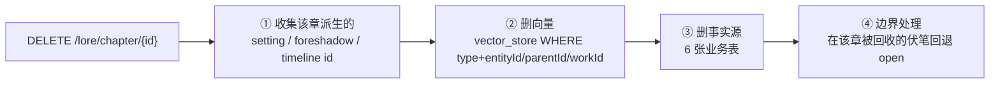

- 向量删除**不能用 `vectorStore.delete`**（`Document.id` 是 UUID，未持久化元数据无法定位），统一用 `jdbcTemplate` 按 `metadata` 的 `type + entityId/parentId/workId` 直删；
- `IN` 拼接必须加单引号（`entityId` 是 text，整数会报 `text = integer`）；
- 删作品级别则一步 `DELETE FROM vector_store WHERE metadata->>'workId'=?` + 删全部业务表，同一 `@Transactional`。

### 5.8 反幻觉设计

- `EntityExtractor`：**无 evidence 的抽取条目直接丢弃**，强制模型给出原文依据；
- `ConflictScanService`：检索后二次过滤只留 `type=chapter`；LLM 判定后代码层只保留 `isConflict=true`；
- 所有 SOP 明确"只引用检索到的设定，禁止脑补新设定"。

### 5.9 前端 SSE 消费的两个细节

- **JWT 放 header 不放 URL query**（避免 token 泄漏到日志/Referer）；
- **必须禁用 `fetch-event-source` 的自动重连**：后端 Agent 是一次性执行，重连会导致**重复执行 + 重复落盘记忆**。做法是 `onclose` 后 `throw` 强制中断重试。

### 5.10 全局作品上下文：version 广播

切换作品 = 后端重签 JWT（换 `workId`）→ 前端写回 auth → **store 的 `version++`**；所有页面 `watch(() => workStore.version)` 清空缓存重拉数据。用响应式信号替代 `window.location.reload()`，保留对话记录与页面状态（未引入 Pinia，用 `reactive()` 单例）。

---

## 6. 效果评测

评测体系分三层：**评测器（纯函数，可单测） + 运行器（真连 DB/LLM，`@Disabled`） + 数据集（JSON，含 golden 样本）**，覆盖「检索 / 归因 / 回答 / Agent」四层（完整方案见 `docs/rag-agent-eval-plan.md`）。

| 评测器                     | 指标                                                                     | 结果                                                                                          |
| -------------------------- | ------------------------------------------------------------------------ | --------------------------------------------------------------------------------------------- |
| `ConsistencyEvaluator`     | 混淆矩阵 → Precision / Recall / **F1** / Accuracy                        | 别名归一前 F1=0.625、Recall=0.714 → **归一后 F1=0.875、Recall=1.000**（14 样本，冲突零漏检） |
| `RagEvaluator`             | **Recall@K** / **MRR** / ContextPrecision@K                             | **`Recall@5 = 1.0`、`MRR = 1.0`**；ContextPrecision 纯函数单测通过                          |
| `LlmJudgeService`（Judge） | Faithfulness / AnswerRelevancy / AnswerAccuracy / unsupportedClaims      | 端到端 10 样本（7 正 + 3 负）**ContextRecall / Faithfulness / Relevancy / Accuracy 全 1.00**   |
| `ScoreAggregator`          | 加权总分 `0.35R+0.25F+0.25A+0.15Rel` + 失败定位（检索/生成掉分）         | **加权总分 = 1.0000**，失败回放无失败样本（10/10 满分）                                        |
| `AgentEvaluator`           | Tool Call F1 + Intent Accuracy + Goal Accuracy                           | **Intent Accuracy=1.0（6/6）、Tool Call F1=1.0、Goal Accuracy=1.0（5/5）**                     |
| `ExtractionEvaluator`      | 实体 P/R/F1 + 伏笔 Accuracy / MAE                                        | 真连 LLM，默认 `@Disabled` 隔离                                                              |

**关键设计**：

- 一致性评测聚焦「归并判定」这一**确定性环节** —— 直接用 `{entity, attribute, valueA, valueB, isConflict}` 驱动 `SettingMergeService.merge`，不端到端走 LLM 抽取（否则随机、无法进 CI）；
- RAG 命中判定用 `metadata.entityId`，不用 pgvector 生成的 `Document.id`（UUID）；
- 负样本刻意用"同值不同实体"而非"无关实体"（后者走 `NEW` 分支，失去区分度）；
- **评测器（Evaluator/Judge）放 `src/main`、进 CI；运行器（真连 DB/LLM）放 `src/test`、`@Disabled`**，遵守"确定性环节不进 LLM"；
- 端到端 QA 的 3 条**无答案负样本**暴露并修复了「无答案场景 LLM 空回答导致前端空白」的 bug（`QUERY_SOP` 强化 + `ToolCallAgent.act` 兜底）——评测体系能反哺产品缺陷。

> 运行：纯函数单测 `mvnw.cmd -Dtest=RagEvaluatorTest,ConsistencyEvaluatorTest,AgentEvaluatorTest,ScoreAggregatorTest test`（无需 DB）；真连运行器（`QaEvalRunnerTest` / `IntentEvalRunnerTest` / `AgentEvalRunnerTest`）需先删 `@Disabled`。

---

## 7. 快速开始

### 前置条件

- JDK **21**、Node **≥ 18**（推荐 20）、Maven（可用仓库内 `mvnw.cmd`）
- PostgreSQL **16+** 且已安装 `pgvector` 与 `pg_trgm` 扩展
- 通义千问 DashScope API Key

### 1. 初始化数据库

```sql
CREATE EXTENSION IF NOT EXISTS vector;
CREATE EXTENSION IF NOT EXISTS pg_trgm;

-- 业务表（幂等脚本见 src/main/resources/db/schema.sql）
\i src/main/resources/db/schema.sql

-- 向量表（也可由应用启动时按配置创建）
CREATE TABLE IF NOT EXISTS vector_store (
    id        uuid PRIMARY KEY DEFAULT gen_random_uuid(),
    content   text,
    metadata   jsonb,
    embedding vector(1536)
);
CREATE INDEX IF NOT EXISTS vector_store_hnsw
    ON vector_store USING hnsw (embedding vector_cosine_ops);
```

### 2. 配置

仓库只提供**脱敏模板**，真实配置需自行复制生成（均已被 `.gitignore` 排除，不会入库）：

```bash
# 主应用
cp src/main/resources/application-local.yml.example src/main/resources/application-local.yml

# database MCP（doc-parser 无敏感配置，直接提交，无需生成）
cp lore-database-mcp-server/src/main/resources/application.yaml.example \
   lore-database-mcp-server/src/main/resources/application.yaml
```

然后填入真实值，或直接通过环境变量注入：

```yaml
spring:
  datasource:
    url: jdbc:postgresql://localhost:5432/LoreKeeper_DB?sslmode=prefer
    username: ${DB_USERNAME}
    password: ${DB_PASSWORD}
  ai:
    dashscope:
      api-key: ${DASHSCOPE_API_KEY}
      chat:
        options:
          model: qwen-max
```

> 建议通过环境变量注入：`DB_USERNAME` / `DB_PASSWORD` / `DASHSCOPE_API_KEY` / `SEARCH_API_KEY` / `LOREKEEPER_JWT_SECRET`。
> ⚠️ `?sslmode=prefer` 建议显式写明：实测云 RDS 在 `disable`（明文被 pg_hba 拒绝）与 `require`（报「服务器不支援 SSL 连线」）下都可能失败，`prefer` 两种配置均兼容。

### 3. 启动

```bash
# 终端 1：主应用（:8080，context-path /api）
./mvnw.cmd spring-boot:run

# 终端 2：database MCP（:8125）
cd lore-database-mcp-server && ../mvnw.cmd spring-boot:run

# 终端 3：doc-parser MCP（:8124）
cd lore-doc-parser-mcp-server && ../mvnw.cmd spring-boot:run

# 终端 4：前端（:5173）
cd xiaoyu-ai-agent-frontend && npm install && npm run dev
```

> MCP 可不启动：主应用对 MCP 走懒连接 + 降级，仅 `parse_document` / `query_database` 相关能力不可用。
> MCP Server 与主应用必须共享同一个 `LOREKEEPER_JWT_SECRET`，否则 401。

打开 `http://localhost:5173`，路由守卫会用演示账号自动登录。

### 4. Docker

```bash
# 后端
docker build -t lorekeeper-back . && docker run -p 8080:8080 lorekeeper-back

# 前端（含 Nginx，已配置 SSE 反代：proxy_buffering off / X-Accel-Buffering no）
cd xiaoyu-ai-agent-frontend && docker build -t lorekeeper-front . && docker run -p 80:80 lorekeeper-front
```

---

## 8. 项目结构

```
ai-aigent/
├── src/main/java/com/xiaoyu/aiaigent/
│   ├── agent/          # Agent 内核：BaseAgent / ReActAgent / ToolCallAgent
│   │                   #            LoreAgentFactory（装配+SOP）/ IntentRouter
│   ├── rag/            # HybridSearchService / RrfMerger / RerankService
│   │                   # PgVectorVectorStoreConfig / ChunkingService / QueryRewriter
│   ├── mcp/            # McpClientPool / BearerSseClientTransport / BoundedMcpToolCallback
│   ├── lore/           # 业务服务：ChapterIngestService / SettingMergeService
│   │                   # ConsistencyReviewService / ConflictScanService / EntityExtractor
│   │                   # FileParseService / WorkService / ...
│   ├── controller/     # 11 个 REST Controller
│   ├── repository/     # 8 个 JdbcTemplate Repository（record 实体）
│   ├── security/       # JwtService / SecurityConfig
│   ├── common/         # TenantContext / TenantFilter
│   ├── chatmemory/     # FileBasedChatMemory（Kryo）
│   ├── tools/          # SettingSearchTool / TerminateTool / WebSearch / PDFGeneration
│   ├── eval/           # 评测器：Consistency/Rag/Score/Agent Evaluator（纯函数）+ LlmJudgeService
│   └── config/         # CORS / 全局异常处理
├── lore-database-mcp-server/     # MCP · :8125 · query_database（只读、白名单）
├── lore-doc-parser-mcp-server/  # MCP · :8124 · parse_document / split_chapters /
│                                #             parse_document_content / detect_encoding
├── xiaoyu-ai-agent-frontend/    # Vue 3 前端（src 25 文件 / ~3.7k 行）
├── docs/screenshots/            # README 界面截图
└── Dockerfile / nginx.conf
```

---

## 9. 接口一览

所有接口前缀 `/api`（除 `/auth/**`、`/health` 外均需 `Authorization: Bearer <JWT>`）。

| 分组   | 方法                      | 路径                                                 | 说明                                                                     |
| ------ | ------------------------- | ---------------------------------------------------- | ------------------------------------------------------------------------ |
| 鉴权   | POST                      | `/auth/register` `/auth/login`                       | 注册 / 登录，签发 JWT                                                    |
| **AI** | GET                       | `/ai/lore/chat`                                      | **统一入口**：意图路由 → Agent → SSE（`intent`/`tool`/`answer`/`error`） |
|        | POST                      | `/ai/lore/review` `/ai/lore/review/file`             | 一致性审查（文本 / 上传文件）                                            |
| 章节   | POST                      | `/lore/chapter/upload` `/lore/chapter/upload-file`   | 单章入库 / 文件上传（TXT·MD·PDF·DOCX）                                   |
|        | GET / DELETE              | `/lore/chapter/list` `/lore/chapter/{id}`            | 列表 / 三级级联删除                                                      |
| 设定   | GET / POST / DELETE       | `/setting/list` `/setting/save` `/setting/{id}`      | 设定 CRUD + 冲突扫描                                                     |
| 伏笔   | GET / POST / DELETE       | `/foreshadow/...`                                    | 伏笔列表 / 新建 / 回收 / 删除                                            |
| 待确认 | GET / POST                | `/pending/list` `/pending/{id}/accept\|reject`       | 人机协同裁决（幂等）                                                     |
| 作品   | GET / POST / PUT / DELETE | `/work/...`                                          | 作品 CRUD + `switch`（重签 JWT）                                         |
| 会话   | GET / DELETE              | `/chat/conversations` `/chat/conversations/{chatId}` | 多会话历史                                                               |
| 可观测 | GET / POST                | `/rag/chunks` `/rag/search`                          | RAG 分块可视化 / 检索测试                                                |
|        | GET / POST                | `/debug/intent` `/debug/mcp/*`                       | 意图路由调试 / MCP 工具真调                                              |

> 接口文档：启动后访问 `/doc.html`（Knife4j）。

---

## 10. 数据模型

| 表                   | 用途                 | 关键字段                                                                                         |
| -------------------- | -------------------- | ------------------------------------------------------------------------------------------------ |
| `users`              | 用户                 | email(unique) / password_hash                                                                    |
| `work`               | 作品（租户隔离单元） | user_id / title / genre / author / intro                                                         |
| `chapter`            | 章节                 | work_id / seq / title / **content（整章原文）**                                                  |
| `world_setting`      | **设定四元组**       | work_id / type / **entity / attribute / value / evidence** / established_chapter / version       |
| `character`          | 角色（别名种子）     | name / **aliases JSONB** / role / ability                                                        |
| `foreshadow`         | 伏笔                 | content / planted_chapter / resolved_chapter / status(open/closed)                               |
| `timeline_event`     | 时间线               | time_point / event / involved_characters JSONB                                                   |
| `pending_conflict`   | **待确认队列**       | entity / attribute / old_value / new_value / evidence / status                                   |
| `consistency_report` | 审查报告             | chapter_id / report_json JSONB                                                                   |
| `vector_store`       | 语义索引             | content / **metadata JSONB（workId/type/entityId/parentId/chapterNo）** / embedding vector(1536) |
| `eval_trace`         | 评测 trace（线上回灌） | work_id / user_message / intent / tool_sequence / answer / loop_guard / step_count / cost_ms |

设计要点：**业务表存"可精确查询的事实"，`vector_store` 存"可语义召回的片段"**，两者必须同步维护 —— 任何落库/更新/删除都要连带维护向量索引。

---

## 11. 已知取舍与后续规划

### 已知取舍

- **SSE 而非 WebSocket**：单向足够，代价是无法中途向 Agent 注入指令；
- **文件记忆而非 Redis/PG**：单机可跑，多实例部署需替换 `ChatMemory` 实现；
- **记忆不回放工具 trace**：为控制记忆体积只存"问答对"，代价是历史回放无过程信息；
- **MCP 降级非无代价**：连接失败返回 `null` 不入缓存，每次请求都会重试 —— 因此下线 MCP 要从配置移除而非仅降级；
- **前端无移动端适配**：桌面端工具型产品定位，未做响应式断点；
- **MVP 无独立登录页**：演示账号自动登录，正式环境需补登录/注册页与密码策略。

### 后续规划

- [ ] **GraphRAG**：角色关系图谱（多跳查询 + 前端可视化，AntV G6 / ECharts graph），解决"角色 A 的师父的宿敌是谁"这类多跳问题；
- [ ] 检索链路加"QUERY 类型偏好排序"（当前长章节原文仍可能挤占设定）；
- [ ] 语义等价归并（「左撇子」vs「惯用左手」）引入 LLM 判定，权衡成本与不确定性；
- [ ] `pending_conflict` / `vector_store` DDL 补齐到 `db/schema.sql`；
- [ ] 密钥全面改为环境变量注入；
- [ ] 前端组件化拆分（弹窗/表格当前在各页重复实现）。
- [ ] 评测集扩充难样本（语义等价 / 多跳 / 跨章矛盾），提升端到端 QA 区分度；
- [ ] 线上失败样本回灌闭环（`eval_trace` 已落表，补自动回灌工具 / 评测报告面板）。

--
